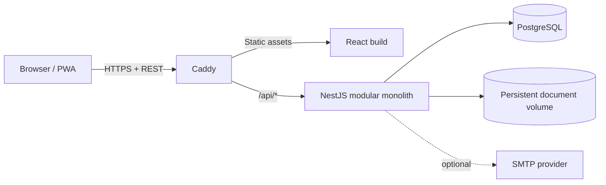
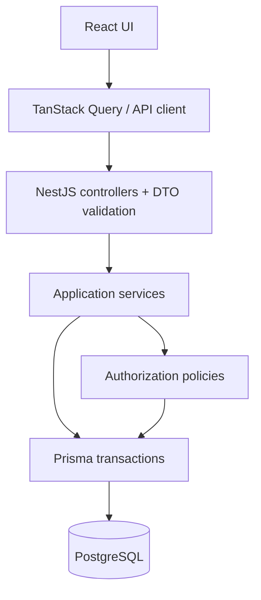

# Arquitectura

## Estado del documento

Este documento define la arquitectura de la V1, que ya está implementada en `apps/api`, `apps/web` y `packages/shared`. Donde el código difirió del diseño inicial (dashboard sin endpoint propio, Web Push diferido) esto se indica en el texto.

## Decisiones principales

- Monorepo con `pnpm workspaces`.
- Frontend React + Vite y backend NestJS.
- TypeScript estricto en todo el repositorio.
- Monolito modular desplegado como una única aplicación backend.
- API REST con prefijo `/api/v1` y contrato OpenAPI.
- Prisma como acceso a PostgreSQL y migraciones versionadas.
- PostgreSQL como fuente de verdad para negocio, sesiones, notificaciones y recordatorios.
- Archivos en almacenamiento persistente fuera de PostgreSQL mediante una abstracción `StorageService`.
- Una sola instancia backend en V1.
- Sin microservicios, Redis, BullMQ ni broker de mensajes.

## Vista general



Caddy termina TLS, sirve el frontend compilado y enruta la API. PostgreSQL no se publica a Internet. El volumen de documentos tampoco se sirve directamente: toda descarga pasa por autorización backend.

## Stack objetivo

### Frontend

- React y Vite.
- React Router para rutas y layouts.
- TanStack Query para estado remoto, caché e invalidación.
- Tailwind CSS y shadcn/ui para sistema visual.
- Lucide para iconografía.
- React Hook Form con Zod para formularios y validación de entrada en cliente.
- Tiptap para notas de reunión.
- FullCalendar para calendarios y la vista temporal sencilla.
- PWA responsive e instalable.

### Backend

- NestJS y TypeScript estricto.
- REST JSON bajo `/api/v1`.
- Swagger/OpenAPI generado desde los contratos del backend.
- Prisma y PostgreSQL.
- Argon2id para contraseñas.
- JWT de acceso y refresh, respaldados por sesiones persistentes.
- Scheduler de NestJS para consultar recordatorios pendientes en PostgreSQL.

### Infraestructura futura

- Docker y Docker Compose.
- Caddy como reverse proxy, TLS y servidor de assets web.
- VPS Linux con volúmenes persistentes y backups externos.

No se deben crear estos componentes de infraestructura hasta una tarea posterior explícita.

## Estructura prevista del monorepo

```text
apps/
  api/                 NestJS, módulos y Prisma
  web/                 React/Vite, rutas y features
packages/
  shared/              contratos, enums y utilidades sin reglas de negocio
docs/                   decisiones funcionales y técnicas
agent-skills/           Agent Skills canónicas
```

`packages/shared` no puede convertirse en un segundo backend. Puede contener tipos serializables, enums, esquemas Zod reutilizables y utilidades puras. Las políticas, permisos, transacciones y validaciones dependientes de datos pertenecen a `apps/api`.

## Monolito modular

Cada módulo NestJS es dueño de su caso de uso y expone servicios explícitos a otros módulos. Ningún módulo debe depender de controladores de otro ni consultar tablas ajenas para saltarse sus invariantes.

Módulos previstos:

- `auth`: credenciales, JWT, cookies y sesiones.
- `invitations`: invitaciones y aceptación.
- `users`: usuarios, estados y perfiles.
- `rbac`: roles, permisos y evaluación global.
- `projects`: proyectos y membresías.
- `tasks`: tareas y asignados.
- `meetings`: reuniones, participantes y notas.
- `documents`: metadata, autorización y almacenamiento.
- `notifications`: notificaciones internas y recordatorios.
- `activity`: actividad legible por proyecto.
- `audit`: eventos administrativos append-only.
- Dashboard: no es un módulo del backend; la pantalla inicial compone lecturas de `schedule`, `projects`, `activity` y `users` (ver [API.md](./API.md)).

Calendario, cronograma, Mi cronograma, equipo y perfiles enriquecidos son consultas o read models sobre módulos existentes. No justifican nuevas tablas ni copias de tareas y reuniones.

Dentro de un módulo, la estructura inicial puede mantenerse simple:

```text
module/
  module.ts
  controller.ts
  service.ts
  dto/
  policies/             sólo cuando la autorización no sea trivial
```

No se exige una arquitectura hexagonal completa. Se separan controladores, servicios de aplicación, políticas de autorización y acceso a datos sólo hasta donde mejore la claridad y las pruebas.

## Dependencias y fuente de verdad



- El frontend puede predecir capacidades para ocultar o deshabilitar controles, pero el backend vuelve a autorizar cada operación.
- Los DTO validan forma y límites; los servicios validan reglas de negocio y acceso al recurso.
- Prisma no se expone a controladores ni al frontend.
- Las operaciones que cambian varias relaciones usan una transacción.
- Los IDs enviados por cliente son referencias a validar, nunca prueba de acceso.

## API y contratos

NestJS usará un prefijo global `api` y versionado URI con versión por defecto `1`, que en conjunto producen `/api/v1`. Esta combinación y la generación OpenAPI mediante el módulo Swagger están soportadas por la documentación actual de NestJS.

Reglas:

- JSON en `camelCase`, UUID como string e instantes ISO 8601 en UTC.
- Fechas de calendario (`startDate`, `dueDate`) usan `YYYY-MM-DD` sin conversión de zona horaria.
- DTOs de entrada y salida explícitos; nunca serializar modelos Prisma directamente.
- Respuestas y errores consistentes según [API.md](./API.md).
- OpenAPI es parte del contrato y debe cambiar junto con el código.
- Los endpoints operativos de healthcheck pueden vivir fuera de `/api/v1` porque no son API de producto.

Un futuro cliente React Native/Expo consumirá los mismos recursos y reglas. V1 no implementará rutas exclusivas para móvil. El transporte del refresh token se encapsulará para que una futura aplicación nativa use almacenamiento seguro sin debilitar la cookie web.

## Autenticación y sesión

El access token JWT dura aproximadamente 15 minutos e incluye como mínimo `sub`, `sid`, `type`, `iat` y `exp`. El refresh token JWT dura aproximadamente 7 días, incluye una sesión y se rota en cada refresh.

En web:

- el access token se mantiene en memoria y se envía como Bearer token;
- el refresh token se entrega en cookie `HttpOnly`;
- el frontend recupera una sesión después de recargar mediante el endpoint de refresh;
- no se guardan tokens en `localStorage`.

Aunque el access token esté firmado, cada petición autenticada comprueba que la sesión continúe vigente y que el usuario esté `ACTIVE`. Esto permite que logout, revocación, suspensión o deshabilitación corten el acceso inmediatamente en lugar de esperar la expiración del JWT.

El refresh token nunca se guarda en texto plano. La sesión conserva un hash y metadatos del dispositivo. La rotación reemplaza el hash de forma atómica. Las reglas detalladas están en [SECURITY.md](./SECURITY.md).

## Autorización

La autorización combina:

1. estado activo del usuario y sesión;
2. condición especial de Owner o permisos globales efectivos;
3. visibilidad del proyecto;
4. rol `MANAGER`, `MEMBER` o `VIEWER` dentro del proyecto;
5. relación con el recurso cuando aplique, por ejemplo organizador, participante, asignado o uploader.

Las políticas se implementan en backend y se prueban con casos permitidos y denegados. [RBAC.md](./RBAC.md) define la matriz normativa.

## Persistencia y transacciones

- Prisma schema y migraciones son artefactos versionados.
- Desarrollo crea migraciones revisables; producción aplica únicamente migraciones comprometidas mediante `prisma migrate deploy`.
- `prisma db push` no sustituye migraciones de producción.
- Constraints e índices que Prisma no pueda expresar se incorporan mediante SQL en la migración y se documentan.
- Las migraciones destructivas requieren estrategia explícita de expansión, backfill, cambio de aplicación y retirada.

Operaciones transaccionales mínimas:

- aceptar invitación, activar usuario y asignar roles;
- rotar refresh token;
- cambiar estado de usuario y revocar sesiones;
- crear proyecto y añadir al creador como `MANAGER`;
- completar o reabrir tarea con `completedAt` coherente;
- actualizar notas comprobando `revision`;
- crear notificación y marcar un recordatorio como entregado.

El modelo completo está en [DATABASE.md](./DATABASE.md).

## Eventos internos, actividad y auditoría

V1 no necesita un broker. Los servicios pueden producir eventos internos tipados dentro del mismo proceso para desacoplar notificaciones, actividad y auditoría, siempre que el cambio de negocio se confirme primero.

Para cambios críticos, el registro de negocio y su evento durable se escriben en la misma transacción. El procesamiento posterior debe ser idempotente. No se introduce un framework de event sourcing ni una infraestructura distribuida.

- `ActivityEvent` alimenta una cronología comprensible dentro de un proyecto.
- `AuditLog` registra acciones de seguridad y administración y no se modifica desde la API.

## Recordatorios persistentes

La API despierta un poller cada 30 segundos mediante el ciclo de vida de NestJS y un timer no bloqueante, sin dependencias adicionales. PostgreSQL conserva el trabajo real. El timer se detiene y espera la entrega en curso al cerrar la aplicación.

Diseño V1:

1. Al crear o cambiar una reunión, se crean o recalculan recordatorios de 24 horas y 1 hora.
2. Un job periódico consulta recordatorios vencidos no entregados.
3. Una transacción crea la notificación con clave de deduplicación y marca el recordatorio como entregado.
4. Si la aplicación reinicia, el siguiente ciclo encuentra lo pendiente.

La entrega bloquea la fila de reunión y revalida el recordatorio dentro de la misma transacción que crea notificaciones con claves únicas y marca la entrega. Usa el mismo orden de locks que las modificaciones de reuniones. Los reinicios y polls simultáneos no duplican entregas; reprogramar conserva entregas anteriores sólo si no cambia su fecha. Reuniones/proyectos eliminados, usuarios inactivos o participantes sin visibilidad actual no reciben recordatorios. No se envían avisos retroactivos de reuniones ya iniciadas.

La topología V1 sigue siendo una única API. Antes de escalar horizontalmente deben resolverse también storage compartido y rate limiting; no Redis por anticipado.

## Reuniones y concurrencia optimista

Las notas Tiptap se guardan como JSON estructurado junto con `revision` y `updatedAt`. El cliente envía `expectedRevision`. La actualización sólo tiene éxito si coincide con la revisión actual y entonces la incrementa. Un conflicto devuelve `409 REVISION_CONFLICT` con información suficiente para recargar; nunca se aplica last-write-wins silencioso.

No habrá WebSockets, CRDT ni presencia en tiempo real en V1.

## Documentos y almacenamiento

El módulo depende de una interfaz pequeña:

```text
StorageService
  put(stream, metadata) -> storageKey
  open(storageKey) -> stream
  delete(storageKey)
  exists(storageKey) -> boolean
```

El adaptador V1 escribe en un volumen persistente privado usando claves generadas, no nombres suministrados por el usuario. La metadata y autorización viven en PostgreSQL. El controlador valida acceso antes de abrir el stream y establece headers seguros al descargar.

La interfaz debe permitir un adaptador posterior para S3, R2 o MinIO sin que proyectos o permisos conozcan el proveedor.

## Frontend y estado

- React Router define layouts públicos, autenticados, de proyecto y administración.
- TanStack Query administra datos remotos; no se duplican en un store global.
- El estado local queda para UI efímera y borradores.
- Las mutaciones invalidan consultas concretas; optimistic updates sólo se usan cuando existe rollback claro.
- Formularios combinan React Hook Form y Zod, pero los errores backend siguen siendo definitivos.
- Los componentes consultan capacidades para UX y manejan correctamente un `403` o `404` del servidor.

## PWA

La PWA cachea el app shell y assets estáticos con versionado. Por defecto no cachea respuestas autenticadas, documentos ni datos sensibles. V1 no permite mutaciones offline: si no hay conexión, muestra el estado y conserva únicamente borradores no sensibles cuando sea seguro.

La instalación es una mejora progresiva; rechazarla o usar un navegador sin soporte no afecta las funciones principales. Web Push no se implementa en V1.

## Configuración

- Configuración mediante variables de entorno validadas al arrancar.
- Ningún secreto entra al bundle web ni al repositorio.
- Los valores públicos del frontend se limitan a los que puedan exponerse al navegador.
- Producción falla al iniciar si faltan secretos o rutas persistentes requeridas.
- SMTP es opcional; su ausencia se refleja como capacidad deshabilitada, no como fallo global. Las variables VAPID existen en la configuración pero V1 no las usa.

La lista operativa se mantiene en [DEPLOYMENT.md](./DEPLOYMENT.md).

## Observabilidad

- Logs JSON estructurados en producción.
- `requestId` propagado en respuesta y logs.
- Actor, acción y entidad en auditoría, sin secretos ni cuerpos completos.
- Healthchecks separados para proceso vivo y dependencias listas.
- Métricas externas pueden añadirse después; V1 no requiere una plataforma dedicada.

## Estrategia de pruebas futura

- Unitarias para reglas puras y políticas de autorización.
- Integración con PostgreSQL para constraints, transacciones, sesiones y consultas.
- API end-to-end para autenticación, RBAC y flujos críticos.
- Componentes/frontend para estados y formularios complejos.
- End-to-end de navegador para login, invitación, proyecto, tarea, reunión y documento.

Cada caso de autorización crítico debe cubrir tanto acceso permitido como denegado, incluidos IDs de recursos ajenos.

## Límites deliberados

- No dividir por microservicios.
- No crear bases de datos por módulo.
- No duplicar entidades para read models pequeños.
- No añadir una cola distribuida para dos recordatorios.
- No implementar colaboración en tiempo real.
- No abstraer Prisma con capas genéricas que oculten queries y transacciones útiles.
- No preparar multi-tenancy agregando `organizationId` a todo el modelo V1.
