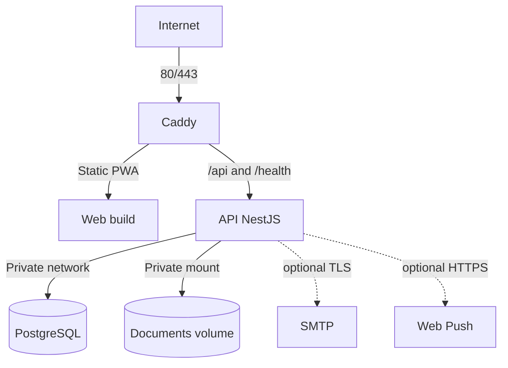

# Despliegue

## Alcance

Este documento define el despliegue objetivo de V1 en una única VPS Linux. No autoriza crear Docker Compose, tocar una VPS, publicar imágenes ni desplegar. Es una guía para una tarea futura explícita.

## Supuestos de V1

- Una sola organización.
- Una sola instancia de la API NestJS.
- PostgreSQL en la misma VPS dentro de una red privada de Docker.
- Caddy como único punto de entrada público.
- Frontend compilado servido como archivos estáticos.
- Documentos en un volumen persistente local.
- SMTP y Web Push opcionales.
- Sin Redis, BullMQ, microservicios ni orquestador de contenedores.

## Topología futura

Servicios previstos:

- `caddy`: TLS, headers, compresión, assets web y reverse proxy.
- `api`: NestJS, Prisma y scheduler de recordatorios.
- `postgres`: PostgreSQL con volumen persistente.

No hace falta un contenedor web en ejecución si Caddy sirve el build estático copiado durante la construcción. Tampoco se crea un worker: el scheduler vive en la única API.

## Red y host

- Publicar únicamente `80/tcp` y `443/tcp`.
- SSH restringido por firewall, llaves y política operativa externa al Compose.
- No publicar el puerto de PostgreSQL.
- API accesible sólo desde Caddy dentro de la red de Docker.
- DNS del dominio apuntando a la VPS antes de solicitar TLS.
- Hora del host sincronizada mediante NTP; aplicación y PostgreSQL trabajan en UTC.
- Sistema operativo soportado y actualizado regularmente.

## Volúmenes persistentes

Como mínimo:

- datos de PostgreSQL;
- documentos subidos;
- datos y configuración persistente de Caddy necesarios para certificados.

Los assets web y la imagen de API son reemplazables y no contienen estado. `STORAGE_ROOT` se monta en la API con permisos de lectura/escritura sólo para su usuario de proceso. Caddy no monta el volumen de documentos.

Los backups deben cubrir PostgreSQL y documentos como un conjunto coherente.

## Variables de entorno

La implementación futura debe validar al arrancar tipos, formato y presencia.

### Aplicación

- `NODE_ENV=production`
- `APP_BASE_URL=https://erp.example.com`
- `WEB_ORIGIN=https://erp.example.com`
- `PORT`
- `LOG_LEVEL`
- `APP_TIME_ZONE` para defaults de presentación/scheduler cuando corresponda; persistencia sigue en UTC.

### PostgreSQL

- `POSTGRES_DB`
- `POSTGRES_USER`
- `POSTGRES_PASSWORD`
- `DATABASE_URL`

La contraseña no se repite en archivos versionados. Cuando sea posible, migraciones y runtime usan credenciales con privilegios diferenciados.

### Autenticación

- `JWT_ACCESS_SECRET`
- `JWT_REFRESH_SECRET`
- `REFRESH_TOKEN_HASH_SECRET`
- `ACCESS_TOKEN_TTL`, default aproximado `15m`.
- `REFRESH_TOKEN_TTL`, default aproximado `7d`.
- `COOKIE_SECURE=true` en producción.
- `INVITATION_TTL_HOURS`, default inicial `72`.

Los tres secretos criptográficos son independientes, aleatorios y suficientemente largos.

### Owner inicial

- `OWNER_EMAIL`
- `OWNER_PASSWORD`
- `OWNER_FIRST_NAME`
- `OWNER_LAST_NAME`

Se usan sólo en un bootstrap/seed idempotente cuando aún no existe Owner. La ejecución no imprime valores ni sobrescribe un Owner existente. Después del alta y rotación de contraseña, retirar `OWNER_PASSWORD` del entorno persistente si el procedimiento operativo lo permite.

### Storage

- `STORAGE_ROOT=/data/documents`
- `MAX_UPLOAD_BYTES`
- allowlist de tipos/extensiones en una configuración validada.

La API falla readiness si el directorio requerido no existe o no es utilizable. Nunca cae silenciosamente al filesystem efímero de la imagen.

### SMTP opcional

- `SMTP_HOST`
- `SMTP_PORT`
- `SMTP_SECURE`
- `SMTP_USER`
- `SMTP_PASSWORD`
- `SMTP_FROM`

Si el bloque no está completo, la capacidad email queda deshabilitada y el flujo ofrece enlace manual de invitación. La ausencia de SMTP no impide iniciar la API.

### Web Push opcional

- `VAPID_PUBLIC_KEY`
- `VAPID_PRIVATE_KEY`
- `VAPID_SUBJECT`

Si faltan, la UI no ofrece suscripción push. Las notificaciones internas siguen funcionando.

## Gestión de secretos

- Archivo de entorno de producción fuera del repositorio y con permisos restrictivos, o mecanismo equivalente del host.
- No usar valores secretos como build args del frontend.
- Sólo variables explícitamente públicas pueden entrar como `VITE_*`.
- No copiar `.env` en imágenes.
- Mantener una plantilla `.env.example` futura con nombres y valores no sensibles.
- Rotar secretos ante exposición y documentar el efecto sobre sesiones.

## Build futuro

El build debe ser reproducible:

1. Usar una versión de Node soportada y fijada por el repositorio.
2. Activar pnpm mediante Corepack o mecanismo documentado.
3. Ejecutar `pnpm install --frozen-lockfile`.
4. Ejecutar `pnpm verify`.
5. Compilar web y API.
6. Crear imágenes con runtime mínimo y usuario no root.
7. No incluir fuentes innecesarias, tests, `.git`, secretos ni cache de paquetes en la imagen final.

No se configurará CI/CD hasta una tarea posterior. El mismo orden debe poder ejecutarse manualmente en un entorno de build controlado.

## Caddy

Responsabilidades:

- redirigir HTTP a HTTPS;
- gestionar certificados TLS;
- servir assets web con cache largo para nombres hasheados;
- servir `index.html` sin cache inmutable para permitir actualizaciones de PWA;
- fallback de rutas React a `index.html`, excepto `/api/*` y `/health/*`;
- reverse proxy de API y healthchecks;
- propagar IP/protocolo mediante headers confiables;
- límites de request/upload coherentes con API;
- security headers definidos en [SECURITY.md](./SECURITY.md).

NestJS sólo confía en proxy cuando la red y configuración identifican a Caddy; no acepta ciegamente headers reenviados desde Internet.

## Migraciones y seed

Flujo de producción:

1. Crear backup previo cuando la migración pueda afectar datos.
2. Ejecutar las migraciones comprometidas mediante `prisma migrate deploy` desde la nueva imagen o un comando one-off.
3. Verificar código de salida y tabla `_prisma_migrations`.
4. Ejecutar seed idempotente sólo cuando corresponda.
5. Iniciar/reemplazar la API.

No usar `prisma db push` en producción. No iniciar múltiples APIs compitiendo por migrar. Una migración destructiva requiere el plan de expansión/contracción de [DATABASE.md](./DATABASE.md).

## Healthchecks

### Liveness

`GET /health/live` confirma que el proceso responde. No ejecuta queries costosas.

### Readiness

`GET /health/ready` comprueba:

- conexión y query mínima a PostgreSQL;
- que migraciones requeridas estén aplicadas según la estrategia de arranque;
- acceso básico al directorio de storage persistente.

SMTP y Web Push opcionales aparecen como capacidades degradadas, pero no bloquean readiness. Las respuestas no revelan credenciales, rutas internas ni versiones innecesarias.

Docker healthcheck debe consultar readiness con intervalos y timeouts razonables. Caddy sólo enruta tráfico a una API lista.

## Procedimiento de despliegue manual

Antes:

1. Revisar release y diff.
2. Confirmar `pnpm verify` exitoso.
3. Revisar cambios de variables de entorno y migraciones.
4. Confirmar espacio en disco y estado del último backup.
5. Crear backup previo si aplica y verificar que terminó.

Despliegue:

1. Construir o descargar artefactos identificados por versión/commit.
2. Aplicar migraciones con un comando one-off.
3. Actualizar servicios sin recrear volúmenes.
4. Esperar readiness.
5. Ejecutar smoke tests autenticados y públicos mínimos.
6. Revisar logs y scheduler.

Después:

- comprobar login/refresh/logout;
- consultar un proyecto y una vista derivada;
- comprobar lectura/escritura controlada de storage sin subir secretos;
- confirmar que no hay migraciones pendientes;
- registrar versión, hora, operador y resultado.

Nada de este procedimiento se ejecuta automáticamente desde agentes salvo instrucción posterior explícita.

## Rollback

- La aplicación puede volver a una imagen anterior sólo si el esquema sigue siendo compatible.
- No ejecutar down migrations destructivas automáticamente.
- Preferir migraciones backward-compatible y despliegues expand/contract.
- Si una migración corrompe o elimina datos, detener escrituras y restaurar backup según el runbook.
- Restaurar PostgreSQL y documentos al mismo punto lógico.
- Documentar cualquier inconsistencia y no ocultarla con un rollback parcial.

## Backups

### Contenido

- dump lógico o backup consistente de PostgreSQL;
- volumen de documentos;
- configuración necesaria para restaurar, sin mezclar secretos en copias inseguras.

### Política inicial sugerida

- backup diario automático;
- retención corta diaria y varias copias semanales/mensuales según capacidad;
- al menos una copia fuera de la VPS;
- cifrado en tránsito y reposo;
- monitoreo del resultado y espacio disponible.

La política final depende del volumen y tolerancia de pérdida del negocio. Debe definirse RPO/RTO antes de producción.

### Prueba de restauración

Periódicamente restaurar en un entorno aislado:

1. Base de datos.
2. Documentos en sus storage keys.
3. Versión compatible de la aplicación.
4. Validación de relaciones y descargas.

Un job exitoso sin prueba de restore no basta.

## Logs y monitoreo

- Contenedores escriben logs estructurados a stdout/stderr.
- Rotación y límites a nivel Docker/host para evitar llenar disco.
- Caddy registra solicitudes sin cookies, Authorization ni query strings sensibles.
- Alertas mínimas futuras: servicio no listo, backup fallido, disco alto, errores 5xx y expiración TLS.
- Auditoría permanece en PostgreSQL; no sustituye logs operativos.

## Mantenimiento

- Actualizar host, imágenes base y dependencias de forma planificada.
- Vigilar crecimiento de PostgreSQL, documentos, logs y backups.
- Purgar sesiones/invitaciones expiradas sólo con una política probada.
- Verificar periódicamente certificados, DNS, restore y permisos del volumen.
- Rotar credenciales y revisar usuarios/roles administrativos.

## Escalado futuro

Si la carga exige varias instancias API, antes se debe resolver:

- coordinación del scheduler y claim idempotente de recordatorios;
- storage compartido u objeto externo;
- rate limiting distribuido si resulta necesario;
- estrategia de sesiones y conexiones PostgreSQL.

Eso no justifica introducir Redis, Kubernetes o microservicios en V1.

## Checklist de release

- lint, typecheck, tests y build exitosos;
- OpenAPI actualizado;
- imágenes construidas sin secretos y con usuario no root;
- configuración Docker/Compose revisada;
- variables requeridas presentes y valores públicos/secretos separados;
- migraciones revisadas, probadas y sin pendientes inesperados;
- backup y plan de rollback acordes al cambio;
- healthchecks y smoke tests definidos;
- volúmenes de PostgreSQL, documentos y Caddy persistentes;
- storage no expuesto por Caddy;
- logs redactados y rotados;
- documentación de despliegue actualizada.
