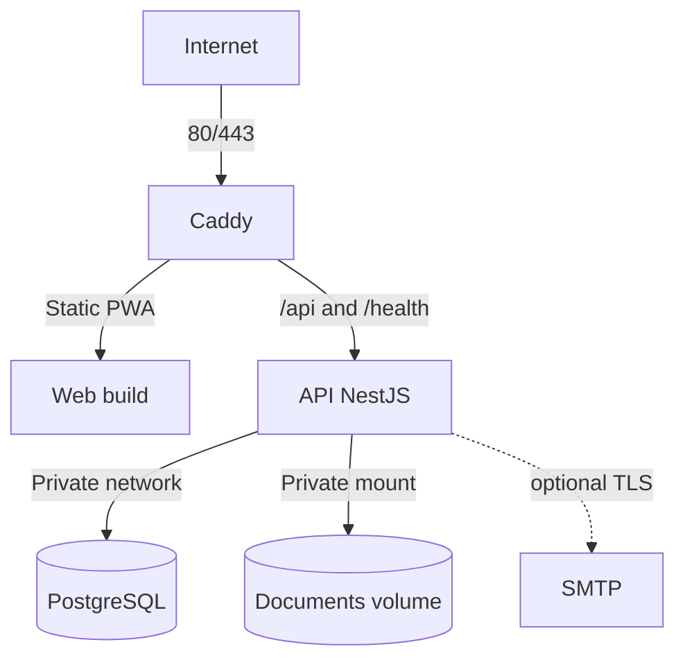

# Despliegue

## Alcance

Este documento define el despliegue de V1 en una única VPS Linux y los procedimientos implementados en el repositorio. Ejecutarlos contra una VPS, publicar imágenes o admitir tráfico requiere autorización operativa explícita; la validación QA sólo usa contenedores locales aislados.

## Supuestos de V1

- Una sola organización.
- Una sola instancia de la API NestJS.
- PostgreSQL en la misma VPS dentro de una red privada de Docker.
- Caddy como único punto de entrada público.
- Frontend compilado servido como archivos estáticos.
- Documentos en un volumen persistente local.
- SMTP opcional. Web Push no forma parte de V1.
- Sin Redis, BullMQ, microservicios ni orquestador de contenedores.

## Topología futura



Servicios previstos:

- `caddy`: TLS, headers, compresión, assets web y reverse proxy.
- `api`: NestJS, Prisma y scheduler de recordatorios.
- `postgres`: PostgreSQL con volumen persistente.

No hace falta un contenedor web en ejecución si Caddy sirve el build estático copiado durante la construcción. Tampoco se crea un worker: el scheduler vive en la única API.

## Red y host

- Publicar únicamente `80/tcp` y `443/tcp`.
- SSH restringido por firewall, llaves y política operativa externa al Compose.
- No publicar el puerto de PostgreSQL.
- API accesible sólo desde Caddy dentro de la red de Docker.
- DNS del dominio apuntando a la VPS antes de solicitar TLS.
- Hora del host sincronizada mediante NTP; aplicación y PostgreSQL trabajan en UTC.
- Sistema operativo soportado y actualizado regularmente.

## Volúmenes persistentes

Como mínimo:

- datos de PostgreSQL;
- documentos subidos;
- datos y configuración persistente de Caddy necesarios para certificados.

Los assets web y la imagen de API son reemplazables y no contienen estado. `STORAGE_ROOT` se monta en la API con permisos de lectura/escritura sólo para su usuario de proceso. Caddy no monta el volumen de documentos.

Los backups deben cubrir PostgreSQL y documentos como un conjunto coherente.

## Variables de entorno

La implementación futura debe validar al arrancar tipos, formato y presencia.

### Aplicación

- `NODE_ENV=production`
- `APP_BASE_URL=https://erp.example.com`
- `WEB_ORIGIN=https://erp.example.com`
- `PORT`
- `LOG_LEVEL`
- `APP_TIME_ZONE` para defaults de presentación/scheduler cuando corresponda; persistencia sigue en UTC.

### PostgreSQL

- `POSTGRES_DB`
- `POSTGRES_USER`
- `POSTGRES_PASSWORD`
- `DATABASE_URL`

La contraseña no se repite en archivos versionados. Cuando sea posible, migraciones y runtime usan credenciales con privilegios diferenciados.

### Autenticación

- `JWT_ACCESS_SECRET`
- `JWT_REFRESH_SECRET`
- `REFRESH_TOKEN_HASH_SECRET`
- `ACCESS_TOKEN_TTL`, default aproximado `15m`.
- `REFRESH_TOKEN_TTL`, default aproximado `7d`.
- `COOKIE_SECURE=true` en producción.
- `INVITATION_TTL_HOURS`, default inicial `72`.

Los tres secretos criptográficos son independientes, aleatorios y suficientemente largos.

### Owner inicial

- `OWNER_EMAIL`
- `OWNER_PASSWORD`
- `OWNER_FIRST_NAME`
- `OWNER_LAST_NAME`

Se usan sólo en un bootstrap/seed idempotente cuando aún no existe Owner. La ejecución no imprime valores ni sobrescribe un Owner existente. Después del alta y rotación de contraseña, retirar `OWNER_PASSWORD` del entorno persistente si el procedimiento operativo lo permite.

### Storage

- `STORAGE_ROOT=/data/documents`
- `MAX_UPLOAD_BYTES`
- allowlist de tipos/extensiones en una configuración validada.

La API falla readiness si el directorio requerido no existe o no es utilizable. Nunca cae silenciosamente al filesystem efímero de la imagen.

### SMTP opcional

- `SMTP_HOST`
- `SMTP_PORT`
- `SMTP_SECURE`
- `SMTP_USER`
- `SMTP_PASSWORD`
- `SMTP_FROM`

Si el bloque no está completo, la capacidad email queda deshabilitada y el flujo ofrece enlace manual de invitación. La ausencia de SMTP no impide iniciar la API.

### Web Push opcional

- `VAPID_PUBLIC_KEY`
- `VAPID_PRIVATE_KEY`
- `VAPID_SUBJECT`

V1 no implementa Web Push: estas variables se validan pero no se usan y pueden dejarse vacías. Las notificaciones internas son el canal.

## Gestión de secretos

- Archivo de entorno de producción fuera del repositorio y con permisos restrictivos, o mecanismo equivalente del host.
- No usar valores secretos como build args del frontend.
- Sólo variables explícitamente públicas pueden entrar como `VITE_*`.
- El build de producción llama a la API en el mismo origen (`/api/v1`, servido por Caddy); no hace falta ningún `VITE_*` para desplegar. `VITE_API_BASE_URL` sólo se usa con `vite dev`.
- Los límites de subida los recibe el frontend de `GET /auth/me`; cambiar `MAX_UPLOAD_BYTES` o `DOCUMENT_ALLOWED_EXTENSIONS` no requiere reconstruir la web (sí subir `MAX_REQUEST_BYTES` de Caddy si corresponde).
- No copiar `.env` en imágenes.
- Mantener una plantilla `.env.example` futura con nombres y valores no sensibles.
- Rotar secretos ante exposición y documentar el efecto sobre sesiones.

## Build futuro

El build debe ser reproducible:

1. Usar una versión de Node soportada y fijada por el repositorio.
2. Activar pnpm mediante Corepack o mecanismo documentado.
3. Ejecutar `pnpm install --frozen-lockfile`.
4. Ejecutar `pnpm verify`.
5. Compilar web y API.
6. Crear imágenes con runtime mínimo y usuario no root.
7. No incluir fuentes innecesarias, tests, `.git`, secretos ni cache de paquetes en la imagen final.

`.github/workflows/ci.yml` ejecuta instalación congelada, lint, typecheck, tests unitarios/HTTP/persistencia, build y validación Docker con smoke de recuperación. No publica imágenes ni despliega. El mismo orden puede ejecutarse manualmente en un entorno controlado.

## Caddy

Responsabilidades:

- redirigir HTTP a HTTPS;
- gestionar certificados TLS;
- servir assets web con cache largo para nombres hasheados;
- servir `index.html` sin cache inmutable para permitir actualizaciones de PWA;
- fallback de rutas React a `index.html`, excepto `/api/*` y `/health/*`;
- reverse proxy de API y healthchecks;
- propagar IP/protocolo mediante headers confiables;
- límites de request/upload coherentes con API;
- security headers definidos en [SECURITY.md](./SECURITY.md).

NestJS sólo confía en proxy cuando la red y configuración identifican a Caddy; no acepta ciegamente headers reenviados desde Internet.

## Migraciones y seed

Flujo de producción:

1. Crear backup previo cuando la migración pueda afectar datos.
2. Ejecutar las migraciones comprometidas mediante `prisma migrate deploy` desde la nueva imagen o un comando one-off.
3. Verificar código de salida y tabla `_prisma_migrations`.
4. Ejecutar seed idempotente sólo cuando corresponda.
5. Iniciar/reemplazar la API.

No usar `prisma db push` en producción. No iniciar múltiples APIs compitiendo por migrar. Una migración destructiva requiere el plan de expansión/contracción de [DATABASE.md](./DATABASE.md).

## Healthchecks

### Liveness

`GET /health/live` confirma que el proceso responde. No ejecuta queries costosas.

### Readiness

`GET /health/ready` comprueba:

- conexión y query mínima a PostgreSQL;
- que migraciones requeridas estén aplicadas según la estrategia de arranque;
- acceso básico al directorio de storage persistente.

SMTP opcional aparece como capacidad degradada, pero no bloquea readiness. Las respuestas no revelan credenciales, rutas internas ni versiones innecesarias.

Docker healthcheck debe consultar readiness con intervalos y timeouts razonables. Caddy sólo enruta tráfico a una API lista.

## Procedimiento de despliegue manual

Antes:

1. Revisar release y diff.
2. Confirmar `pnpm verify` exitoso.
3. Revisar cambios de variables de entorno y migraciones.
4. Confirmar espacio en disco y estado del último backup.
5. Crear backup previo si aplica y verificar que terminó.

Despliegue:

1. Construir o descargar artefactos identificados por versión/commit.
2. Aplicar migraciones con un comando one-off.
3. Actualizar servicios sin recrear volúmenes.
4. Esperar readiness.
5. Ejecutar smoke tests autenticados y públicos mínimos.
6. Revisar logs y scheduler.

Después:

- comprobar login/refresh/logout;
- consultar un proyecto y una vista derivada;
- comprobar lectura/escritura controlada de storage sin subir secretos;
- confirmar que no hay migraciones pendientes;
- registrar versión, hora, operador y resultado.

Nada de este procedimiento se ejecuta automáticamente desde agentes salvo instrucción posterior explícita.

## Rollback

- La aplicación puede volver a una imagen anterior sólo si el esquema sigue siendo compatible.
- No ejecutar down migrations destructivas automáticamente.
- Preferir migraciones backward-compatible y despliegues expand/contract.
- Si una migración corrompe o elimina datos, detener escrituras y restaurar backup según el runbook.
- Restaurar PostgreSQL y documentos al mismo punto lógico.
- Documentar cualquier inconsistencia y no ocultarla con un rollback parcial.

## Backups

### Contenido

- dump lógico o backup consistente de PostgreSQL;
- volumen de documentos;
- configuración necesaria para restaurar, sin mezclar secretos en copias inseguras.

### Política inicial sugerida

- backup diario automático;
- retención corta diaria y varias copias semanales/mensuales según capacidad;
- al menos una copia fuera de la VPS;
- cifrado en tránsito y reposo;
- monitoreo del resultado y espacio disponible.

La política final depende del volumen y tolerancia de pérdida del negocio. Debe definirse RPO/RTO antes de producción.

### Prueba de restauración

Periódicamente restaurar en un entorno aislado:

1. Base de datos.
2. Documentos en sus storage keys.
3. Versión compatible de la aplicación.
4. Validación de relaciones y descargas.

Un job exitoso sin prueba de restore no basta.

## Logs y monitoreo

- Contenedores escriben logs estructurados a stdout/stderr.
- Rotación y límites a nivel Docker/host para evitar llenar disco.
- Caddy registra solicitudes sin cookies, Authorization ni query strings sensibles.
- Alertas mínimas futuras: servicio no listo, backup fallido, disco alto, errores 5xx y expiración TLS.
- Auditoría permanece en PostgreSQL; no sustituye logs operativos.

## Mantenimiento

- Actualizar host, imágenes base y dependencias de forma planificada.
- Vigilar crecimiento de PostgreSQL, documentos, logs y backups.
- Purgar sesiones/invitaciones expiradas sólo con una política probada.
- Verificar periódicamente certificados, DNS, restore y permisos del volumen.
- Rotar credenciales y revisar usuarios/roles administrativos.

## Escalado futuro

Si la carga exige varias instancias API, antes se debe resolver:

- coordinación del scheduler y claim idempotente de recordatorios;
- storage compartido u objeto externo;
- rate limiting distribuido si resulta necesario;
- estrategia de sesiones y conexiones PostgreSQL.

Eso no justifica introducir Redis, Kubernetes o microservicios en V1.

## Checklist de release

- lint, typecheck, tests y build exitosos;
- OpenAPI actualizado;
- imágenes construidas sin secretos y con usuario no root;
- configuración Docker/Compose revisada;
- variables requeridas presentes y valores públicos/secretos separados;
- migraciones revisadas, probadas y sin pendientes inesperados;
- backup y plan de rollback acordes al cambio;
- healthchecks y smoke tests definidos;
- volúmenes de PostgreSQL, documentos y Caddy persistentes;
- storage no expuesto por Caddy;
- logs redactados y rotados;
- documentación de despliegue actualizada.

## Desarrollo Windows (PowerShell)

Requisitos: Node 22.22.3, pnpm 12.6.0 (campo `packageManager`), Docker Desktop con contenedores Linux y Compose v2. Usar sólo el proyecto/volumen de desarrollo; las suites HTTP y persistencia escriben fixtures y necesitan una base dedicada, nunca producción.

```powershell
corepack enable
pnpm install --frozen-lockfile
Copy-Item .env.example .env
Copy-Item apps/api/.env.example apps/api/.env
# Editar ambas copias: credenciales locales coincidentes y tres secretos diferentes.
docker compose -f docker-compose.yml -f docker-compose.dev.yml config --quiet
docker compose -f docker-compose.yml -f docker-compose.dev.yml up -d --wait postgres
pnpm --filter api prisma:migrate:deploy
pnpm --filter api seed
New-Item -ItemType Directory -Force apps/api/uploads
pnpm --filter api start:dev
```

PostgreSQL queda en `127.0.0.1:55432`; `apps/api/.env` usa ese hostname/puerto, no `postgres`. Ejecutar los comandos pnpm desde la raíz (el filtro cambia al directorio API). No reutilizar credenciales de una VPS. `prisma:migrate:dev` es sólo para crear nuevas migraciones en desarrollo; el rol creado en un volumen dev nuevo puede crear la shadow DB. Un volumen inicializado previamente no reejecuta scripts: revisar sus grants expresamente, no borrarlo para cambiar permisos.

Validación: `pnpm verify`; con base QA y Owner sembrado, ejecutar además `pnpm --filter api test:e2e` y `pnpm --filter api test:persistence`. El verify raíz no incluye esas dos suites. Los shell scripts mantienen LF mediante `.gitattributes`. Backup/restore binario debe ejecutarse en Bash Linux/WSL o Git Bash, nunca redireccionar el dump con PowerShell 5.1 (convierte bytes). En Git Bash puede ser necesario `export MSYS2_ARG_CONV_EXCL=/data` para conservar rutas internas Docker.

## Runbook Linux VPS (manual, no ejecutado por CI)

Requisitos: Docker Engine y Compose v2 actuales, Bash, espacio suficiente, DNS/TLS y firewall previamente preparados. No pasar `docker-compose.dev.yml` en producción. Sólo Caddy publica puertos; la API corre no-root, sin capacidades adicionales, con `no-new-privileges` y uploads privados. Logs Docker rotan a 3 archivos de 10 MiB por servicio.

Guardar la copia editada de `.env.example` fuera del checkout, por ejemplo `/etc/erp/erp.env`, con permisos `0600`. Usar contraseñas largas y tres secretos aleatorios diferentes de al menos 32 caracteres; las URLs públicas deben ser HTTPS y `COOKIE_SECURE=true`. Escapar porcentualmente caracteres especiales de la contraseña en `DATABASE_URL`. `APP_DB_USER` debe ser distinto de `POSTGRES_USER`. El rol app no es superuser y no puede crear roles/bases en producción, pero sigue siendo owner de su base/esquema: no equivale a una separación completa entre DDL y runtime. `DATABASE_MIGRATION_URL` permite una credencial de migración separada si los grants se preparan manualmente.

```bash
docker compose -p erp --env-file /etc/erp/erp.env config --quiet
docker compose -p erp --env-file /etc/erp/erp.env build api caddy
# Sólo en primera instalación: usar el perfil explícito de bootstrap.
docker compose -p erp --env-file /etc/erp/erp.env run --rm migrate
docker compose -p erp --env-file /etc/erp/erp.env --profile bootstrap run --rm --no-deps seed
# El servicio migrate debe terminar con éxito antes de iniciar API.
docker compose -p erp --env-file /etc/erp/erp.env up -d --wait api caddy
```

El seed compilado funciona dentro de la imagen sin `tsx`; no se ejecuta automáticamente. Después de bootstrap retirar `OWNER_PASSWORD` del archivo y rotar la contraseña del Owner. Esas variables nunca se inyectan en el servicio API persistente. La imagen admite `--migrate` y `--seed`; un arranque/reinicio normal sólo inicia Node. Un fallo de migrate bloquea el arranque dependiente. Para upgrades, hacer backup previo, identificar `ERP_IMAGE_TAG`, ejecutar migrate con la nueva imagen y comprobar readiness antes de admitir tráfico. No ejecutar seed para resetear un Owner existente.

`MAX_REQUEST_BYTES` en Caddy limita la petición multipart completa; debe superar `MAX_UPLOAD_BYTES` con margen (defaults 26 MiB y 25 MiB). Los paths `/api`, `/api/*`, `/health` y `/health/*` nunca reciben fallback SPA. API envía `Cache-Control: no-store`; index y rutas SPA reciben `no-cache`. Readiness comprueba DB/storage; el gate de migraciones lo proporciona Compose, no una consulta a `_prisma_migrations` en cada healthcheck.

## Backup y recuperación implementados

```bash
bash deploy/backup.sh /etc/erp/erp.env /var/backups/erp erp
# Restauración exclusivamente aislada, con volúmenes nuevos y API detenida:
bash deploy/restore.sh /etc/erp/restore.env erp-restore /var/backups/erp/FECHA-ID
```

`backup.sh` detiene temporalmente la API (también el poller), conserva PostgreSQL activo, crea `database.dump` y `documents.tar.gz`, verifica el formato del dump y escribe `SHA256SUMS` sólo al completar ambos. Un trap reinicia la API si estaba activa, incluso ante error. Programarlo fuera de horas pico; detener también cualquier writer externo. El directorio destino debe ser absoluto y fuera del checkout. No copiar dumps por red sin cifrado. El script no elimina copias ni configura cron/retención; el operador debe implementar backup diario, cifrado, copia externa, alertas, política RPO/RTO y prueba periódica.

`restore.sh` exige proyecto terminado en `-restore`, checksums correctos, base sin tablas públicas, uploads vacíos y API detenida. Rechaza sobrescribir datos, paths no UUID, links y archivos especiales en el tar. Restaura SQL en una única transacción con el rol app y luego los archivos; mantiene la API apagada. Si falla el paso de archivos, no admitir tráfico ni intentar mezclar estados: corregir la causa y repetir en un entorno aislado nuevo. No automatiza borrado ni promoción del recovery.

Después: comprobar `_prisma_migrations`, Owner/RBAC, relaciones y checksum/descarga de documentos, iniciar sólo la API aislada con imagen compatible y verificar `/health/ready`. Revisar login/refresh/logout y pendientes de recordatorios. El archivo de recuperación puede usar otros secretos para invalidar sesiones restauradas; no conectar SMTP/push ni dominio productivo durante el ensayo. No hacer `down --volumes` en producción.
